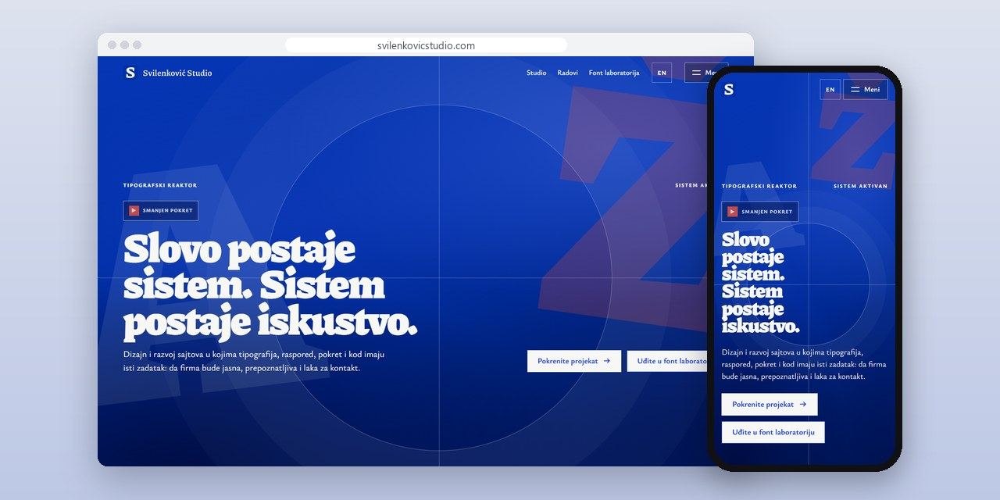
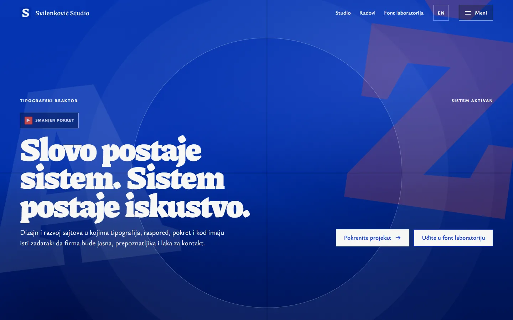
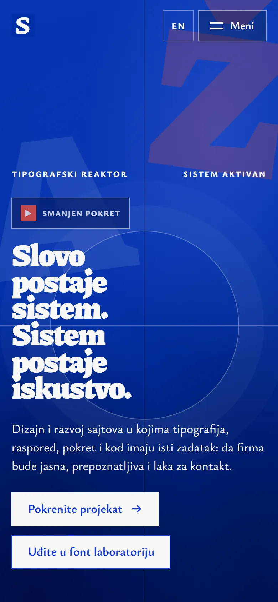
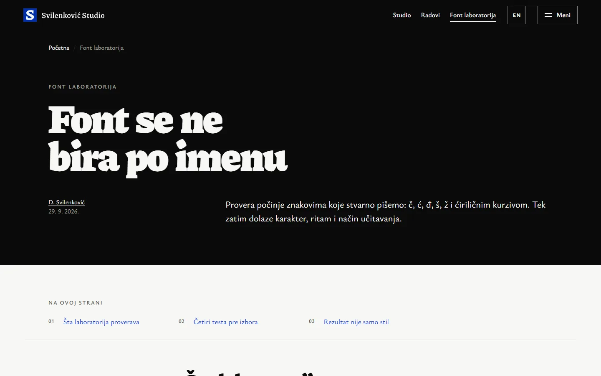

# Svilenković Studio

A design studio site where large letters unfold into the page layout, with a font lab that tests typefaces on Serbian text.

**[svilenkovicstudio.com](https://svilenkovicstudio.com/)** · [Case study (in Serbian)](https://svilenkovic.rs/radovi/svilenkovic-studio) · [Srpski](README.sr.md)

> [!NOTE]
> My own project, not client work. The source code is private. This page describes what the site does and how it is built.

<table>
  <tr><td><b>Client</b></td><td>Own project</td></tr>
  <tr><td><b>Industry</b></td><td>Typography, interaction and design systems</td></tr>
  <tr><td><b>Location</b></td><td>Serbia</td></tr>
  <tr><td><b>Type</b></td><td>Multi-page website</td></tr>
  <tr><td><b>My role</b></td><td>Research, design, development, SEO and hosting</td></tr>
  <tr><td><b>Stack</b></td><td>Astro 7, three.js, GSAP, harfbuzzjs, PHP 8.3, SQLite, nginx</td></tr>
</table>

## About the project

Svilenković Studio is about the visible part of web work: type, rhythm, spacing and motion. The home page starts with large letters that grow into the structure of the page, and the headline stays real text that can be read without a script. Other pages cover fonts for Cyrillic and Latin, Serbian italics, colours, logos and the design process.

The font lab starts with the letters we actually write, č, ć, đ, š and ž, and only then looks at character and rhythm, so a reader can see why a typeface works instead of taking its name on trust. The main scene is built with three.js and tied to scroll, with performance limits and a fallback. On a phone the composition is shorter, and with reduced motion the content sits in its final state.

## What I built

- A font lab with checked Google fonts for Serbian Latin with diacritics, Cyrillic and Serbian italics, loaded from the same domain
- A three.js scene tied to scroll, with performance limits and a fallback
- Pages on Cyrillic and Latin fonts, Serbian italics, colours, logos and the design process
- Reduced motion and no-JavaScript paths that keep every text readable
- Serbian and English versions of every page

## Results

| | Performance | Accessibility | Best practices | SEO |
| :-- | :-: | :-: | :-: | :-: |
| Mobile | 100 | 100 | 100 | 100 |
| Desktop | 100 | 100 | 100 | 100 |

PageSpeed Insights, lab test of the live site, October 2026. Security headers: 6 of 6. axe accessibility check: no violations. Structured data: `Person`.

## Screenshots

<table>
  <tr>
    <td width="68%" valign="top"></td>
    <td width="32%" valign="top"></td>
  </tr>
</table>

Font lab on the live site

---

Built by [D. Svilenković](https://svilenkovic.com).
